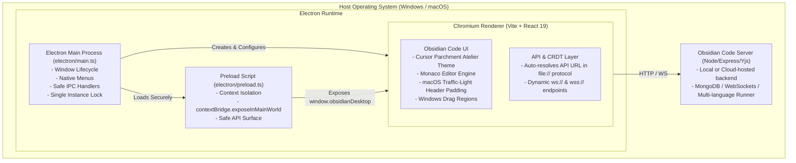

# Obsidian Code — Cross-Platform Desktop Application (Windows & macOS) Implementation Plan

## Executive Summary
This document outlines the end-to-end engineering plan to package and optimize **Obsidian Code** as a first-class, cross-platform desktop application supporting both **Windows** (x64) and **macOS** (Apple Silicon arm64 & Intel x64) using **Electron** and **electron-builder**.

---

## Architecture Overview

---

## Detailed Implementation Phases

### Phase 1: Tooling, Dependencies & TypeScript Setup
- [x] Install Electron desktop development toolchain:
  - `electron` (runtime)
  - `electron-builder` (packaging for Windows NSIS/Portable and macOS DMG/Zip)
  - `vite-plugin-electron` (seamless Vite HMR and build integration)
  - `cross-env` (cross-platform environment variable configuration)
- [x] Configure TypeScript (`tsconfig.json` & `src/types/electron.d.ts`) to compile `electron/` directory with strict typing.
- [x] Add desktop scripts to `package.json`:
  - `desktop:dev` — Runs Vite dev server with Electron in watch/HMR mode with backend.
  - `desktop:client` — Runs Vite client with Electron in standalone mode.
  - `desktop:build` — Compiles Electron main, preload, client assets, and invokes `electron-builder`.
  - `desktop:build:win` / `desktop:build:mac` / `desktop:pack`.
  - Preserved all existing web scripts (`dev`, `build`, `typecheck`, `test`).

### Phase 2: Electron Main Process & Secure Preload Bridge
- [x] Create `electron/main.ts`:
  - Initialize `BrowserWindow` with warm parchment dark background (`#1c1b17`) to prevent white flash during startup.
  - macOS window ergonomics: `titleBarStyle: 'hiddenInset'`, `trafficLightPosition: { x: 16, y: 16 }`.
  - Security hardening:
    - `contextIsolation: true`
    - `nodeIntegration: false`
    - `sandbox: true`
    - `webSecurity: true`
  - Safe navigation guards: restrict new window creation and web navigations to strictly allowlisted protocols (`http:` and `https:` opened in OS default browser).
  - Single instance locking to prevent duplicate processes.
  - Native platform menus (macOS Application Menu, Edit, View, Window, Help) with proper Mac (`Cmd`) vs Windows (`Ctrl`) keyboard accelerators.
  - IPC handlers for window state (`minimize`, `maximize`, `close`, `isMaximized`).
- [x] Create `electron/preload.ts`:
  - Expose safe `window.obsidianDesktop` bridge via `contextBridge.exposeInMainWorld`.
  - Expose `platform` (`'win32' | 'darwin' | 'linux'`), `isDesktop: true`, and window control actions.
- [x] Create TypeScript declaration `src/types/electron.d.ts` for type safety in React components.

### Phase 3: Client & Workspace UI Desktop Integration
- [x] Update `vite.config.ts`:
  - Integrate `vite-plugin-electron` conditionally when building for desktop via `ELECTRON=true`.
  - Ensure asset base URLs resolve cleanly for desktop packaged builds (`base: './'`).
- [x] Adapt `src/lib/api.ts` and `src/lib/crdt/docManager.ts`:
  - Handle `file://` or custom protocol resolution: provide fallback backend URL (`http://localhost:5000` or `import.meta.env.VITE_API_URL`) so REST and WebSocket connections succeed in packaged desktop mode.
- [x] Desktop UI Polish & macOS Traffic Light integration:
  - Added top bar styling adjustments when running in desktop mode:
    - On macOS: Added left padding to the header (`pl-20`) so native traffic-light buttons do not collide with brand mark.
    - Window drag region (`app-drag-region`) on blank header areas and (`app-no-drag`) on buttons, inputs, tabs, and menus in both `Header.tsx` and `Dashboard.tsx`.

### Phase 4: Packaging & Cross-Platform Distribution Configuration
- [x] Configure `electron-builder` via `electron-builder.json5`:
  - App ID: `com.obsidiancode.app`
  - Product Name: `Obsidian Code`
  - Directories: `output: dist/desktop`
  - Windows:
    - Target: NSIS installer (`.exe`) & Portable (`.exe`)
    - Architecture: `x64`
    - Icon: `build/icon.png`
    - Custom installer and uninstaller options
  - macOS:
    - Target: DMG (`.dmg`) & Zip (`.zip`)
    - Architecture: Universal (`x64` and `arm64`)
    - Category: `public.app-category.developer-tools`
    - Hardened runtime enabled with `build/entitlements.mac.plist`
    - Icon: `build/icon.png`
- [x] Set `"main": "dist-electron/main.js"` in `package.json`.

### Phase 5: Verification & Quality Assurance
- [x] TypeScript compilation verification: `npm run typecheck` passed with 0 errors.
- [x] Vitest test suite execution: `npm run test` passed (33/33 test files, 127/127 tests passed).
- [x] Web production build check: `npm run build` succeeded cleanly in 3.01s.
- [x] Desktop packaging verification: `npm run desktop:pack` and `npm run desktop:build:win` completed successfully.
- [x] Desktop OAuth architecture:
  - Local loopback server (`http://localhost:3000`) serving SPA for valid OAuth redirect origins.
  - Allowed Clerk (`*.clerk.accounts.dev`, `clerk.com`) and identity provider (`accounts.google.com`, `github.com`) in navigation guards.
  - User-Agent normalization removing Electron token to resolve Google's "Disallowed Useragent" block.
  - Added loopback origins to backend CORS allowlist in `server/index.ts`.

